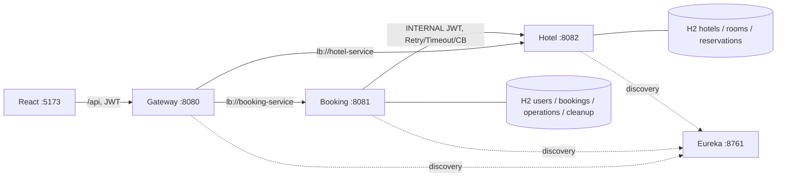
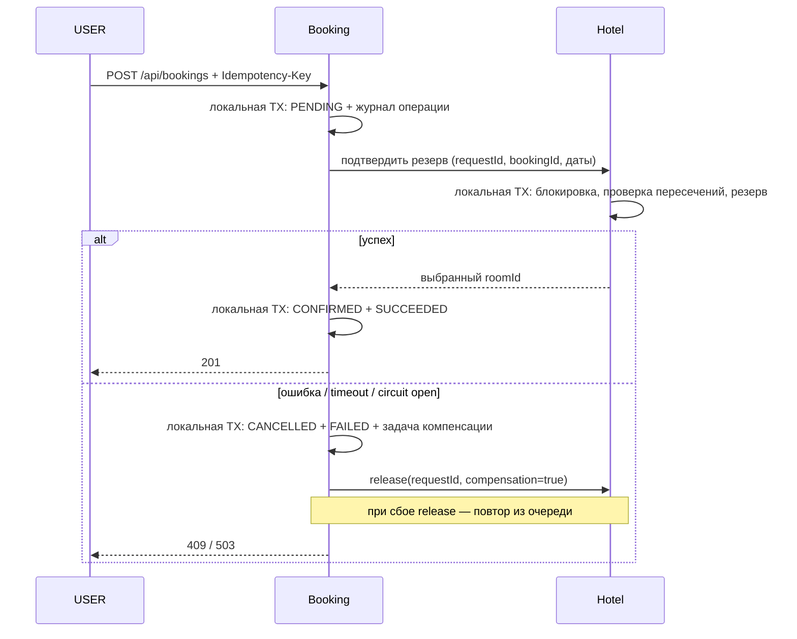

# Система бронирования отелей

Четыре самостоятельных Spring Boot приложения, React-клиент и общая Java-библиотека. Java **22**, Spring Boot **4.1.2**, Spring Cloud **2025.1.4**, React 19 / Vite 7. Для запуска нужны JDK 22, Node.js 20.19+ (или 22.12+), npm, Make и curl. Gradle Wrapper включён в каждый сервис.

## Запуск

```sh
make build       # JAR, тесты, проверка форматирования; npm ci, тесты и production bundle
make start       # фоновые процессы; ожидание health и регистрации в Eureka
# либо make up — сборка и запуск
make demo        # демонстрационные брони через API (после запуска)
make status
make logs
make stop
```

Приложение: http://localhost:5173. Все запросы React идут через Vite proxy → Gateway. `make start` использует Vite dev server; собранный bundle находится в `frontend/dist`. `make restart` перезапускает всё приложение. Логи и сведения о процессах: `.runtime/` (не включаются в исходники). Makefile проверяет принадлежность PID и не останавливает процессы, запущенные вне него. При ошибке запуска останавливаются только процессы текущей попытки.

`make test` — Java unit/integration-тесты сервисов и HTTP-клиента, а также JavaScript-тесты frontend; `make e2e` — JUnit-сценарии из `integration_tests` на запущенных сервисах, включая 12 конкурентных запросов. E2E создаёт изолированные тестовые учётную запись и отель; данные остаются до перезапуска. `make format` / `make check` — Google Java Format через Spotless.

| Компонент | Порт | Назначение |
|---|---:|---|
| frontend | 5173 | React JS, русский интерфейс |
| API_gateway | 8080 | маршруты `lb://`, JWT, роли, корреляция |
| booking_service | 8081 | пользователи, JWT, брони, оркестрация саги |
| hotel_management_service | 8082 | отели, номера, резервы, распределение, аналитика |
| eureka_server | 8761 | discovery, панель http://localhost:8761 |
| common | — | Java-библиотека: JWT, ErrorDTO, trace filter, OpenAPI |

Swagger UI доступен напрямую: http://localhost:8081/swagger-ui.html и http://localhost:8082/swagger-ui.html; JSON `/v3/api-docs`. В Swagger нажмите Authorize и вставьте JWT. Внутренние маршруты видны в спецификации Hotel, но закрыты для USER/ADMIN и не публикуются Gateway.

## Демо-данные

| Логин | Пароль | Роль |
|---|---|---|
| admin | Admin123! | ADMIN |
| alice | User12345! | USER |
| bob | User12345! | USER |

При старте созданы два отеля, восемь номеров (один выведен из эксплуатации). `make demo` идемпотентно создаёт на ближайшие даты подтверждённую, отменённую и перенесённую брони, а также неуспешную попытку бронирования недоступного номера с компенсацией. Повторный вызов в тот же день использует те же ключи. Войти как alice для просмотра истории; admin для CRUD и статистики.

H2 работает **in-memory**: остановка сервиса уничтожает его данные. Две БД независимы. Для демонстрации перезапускайте всё приложение вместе; отказ отдельного сервиса с потерей его H2 не моделирует перезапуск с сохранением БД. Журналы операций/компенсаций сохраняются в локальной БД, поэтому переживают ошибки запросов и повторные доставки, но не уничтожение in-memory БД.

## Архитектура





Подробности: [схема БД](docs/database.md), [контракт API](docs/api.md), [структура пакетов](docs/structure.md).

## Правила предметной области

* Даты — полуинтервалы `[startDate, endDate)`: выезд и следующий заезд в один день разрешены. Хотя бы одна ночь, заезд не в прошлом. В расчётах используется локальная дата сервиса; запускайте сервисы в одной временной зоне (например, `TZ=Europe/Moscow make start`).
* `available` — эксплуатационная доступность, занятость определяется пересечением активных резервов по датам. Бронирования находятся в Booking; их локальная проекция резервов — в Hotel.
* `times_booked` — историческое число успешных бронирований номера: одна пара bookingId/roomId учитывается один раз. Перенос в ранее не использованный этой бронью номер увеличивает его счётчик; изменение дат того же номера или возвращение в него не увеличивает счётчик повторно. Счётчик старого номера сохраняется. Отмена подтверждённой брони не уменьшает счётчик; компенсация неуспешного назначения уменьшает его ровно один раз. Во время незавершённой саги резерв учитывается предварительно.
* Рекомендации: свободные номера по `times_booked ASC, id ASC`. Hotel повторно выбирает наименее загруженный номер под блокировкой, поэтому параллельные автоподборы учитывают результаты друг друга.
* Перенос: старая бронь остаётся CONFIRMED и старый слот защищён до подтверждения нового. При ошибке старый резерв сохраняется. При успехе смена данных и постановка освобождения старого резерва фиксируются одной локальной транзакцией. Пока освобождение не завершено, слот может оставаться избыточно занят, но двойное бронирование невозможно.
* ADMIN управляет отелями, номерами и пользователями, смотрит аналитику; пользовательские бронирования ADMIN запрещены. USER видит только свои брони; чужой ID возвращает 404.
* DELETE пользователя отключает учётную запись и запрещает вход, сохраняя историю. Собственную административную запись отключить/разжаловать нельзя. Уже выданный JWT действителен до истечения часа на Hotel/Gateway; Booking дополнительно проверяет активность USER при операциях с бронями. Изменение роли требует повторного входа для нового JWT.
* Удаление номера с историей резервов — 409, используйте `available=false`. Удаление отеля с номерами — 409.

## Надёжность и конфигурация

Удалённые вызовы: connect/read timeout 1800 мс; максимум 3 попытки с задержками 100/200 мс, только для сетевых ошибок и 5xx. 4xx не повторяются. CircuitBreaker: окно 6 вызовов, минимум 4, порог 50%, открытие 10 секунд. Компенсация использует отдельный путь без CircuitBreaker. Невыполненные задачи повторяются с экспоненциальной задержкой до 60 секунд. PENDING старше 45 секунд восстанавливается в FAILED с компенсацией каждые 5 секунд. Глобальных транзакций нет; HTTP-вызовы выполняются вне локальных транзакций Booking.

Идемпотентность: UUID в `Idempotency-Key` обязателен для POST/PUT/DELETE бронирований. Тот же ключ и параметры возвращают сохранённый результат; другой payload — 409; параллельный незавершённый запрос — 409; FAILED повторяет сохранённую ошибку. Для новой попытки после завершённой ошибки нужен новый ключ. React сохраняет ключ при потере сетевого ответа. Hotel использует ключ как ID резерва; освобождение создаёт метку даже для неизвестного ключа, запрещая запоздалый reserve.

`X-Trace-Id` передаётся Gateway → Booking → Hotel; неверный/отсутствующий заменяется UUID. Логи в JSON ECS, шаги саги содержат bookingId/requestId. В ответах ошибок единый ErrorDTO: timestamp, status, message, path, traceId. Пароли и JWT не логируются.

Переменные окружения:

| Переменная | Значение по умолчанию |
|---|---|
| JWT_SECRET | демонстрационный общий HMAC secret (переопределить для внешнего запуска, минимум 32 байта) |
| EUREKA_URL | http://localhost:8761/eureka/ |
| HOTEL_URL | http://hotel-service — разрешение через Eureka; прямой URL допустим для тестов |
| GATEWAY_URL | http://localhost:8080 — proxy Vite / Java HTTP-клиент |
| SEED_ENABLED | true; false отключает демонстрационные учётные записи и отели |

Spring properties можно переопределять стандартными переменными окружения. H2 Console включена на прямых портах сервисов только для локальных подключений (`web-allow-others=false`); через Gateway не публикуется. `/actuator/health` публичен; наружу Gateway маршрутизирует только API. Eureka и прямые порты сервисов предназначены для локального учебного окружения.

## H2 Console

* Booking: http://localhost:8081/h2-console/ — JDBC URL `jdbc:h2:mem:booking-service`.
* Hotel: http://localhost:8082/h2-console/ — JDBC URL `jdbc:h2:mem:hotel-service`.

Драйвер `org.h2.Driver`, пользователь `sa`, пароль пустой. Сервисы должны быть запущены. JWT для формы консоли не требуется: используется вход H2. Для консоли разрешены same-origin frames отдельной SecurityFilterChain; правила JWT и заголовки безопасности REST API сохраняются. Из внешнего процесса IDE эти in-memory базы по JDBC URL недоступны. Для отключения консоли задайте `SPRING_H2_CONSOLE_ENABLED=false`. После остановки JVM данные исчезают.

## Java-тесты и запуск без дополнительных скриптов

Все backend unit/integration-тесты написаны на Java/JUnit. Модуль `integration_tests` содержит HTTP-клиент, его модульные тесты, шесть сквозных JUnit-сценариев и Java-программу демо-предзаполнения. `make test` не требует запущенных сервисов; `make e2e` и `make demo` выполняются после `make start`. Отчёт E2E: `integration_tests/build/reports/tests/e2e/index.html`. JavaScript-тесты frontend сохранены.

Запуск и остановка реализованы непосредственно shell-командами Makefile: `nohup java -jar`, `nohup node`, `curl`, `ps` и `kill`. PID и подпись времени запуска сохраняются в `.runtime/*.pid` и `*.signature`; при повторном старте уже работающие процессы не дублируются. Поддерживается системный GNU Make 3.81 в macOS. Python и отдельный скрипт управления процессами не требуются. `GATEWAY_URL` задаёт адрес Gateway для Java-клиента и Vite; `HOTEL_TEST_URL` — прямой адрес Hotel для проверки защиты внутренних операций (по умолчанию http://localhost:8082).

Порты Makefile можно переопределить: `EUREKA_PORT`, `HOTEL_PORT`, `BOOKING_PORT`, `GATEWAY_PORT`, `FRONTEND_PORT`. Сервисы, запускаемые Makefile локально, регистрируются в Eureka с адресом `127.0.0.1`, чтобы смена сетевого интерфейса компьютера не нарушала discovery.

Подробная [структура пакетов и правила расширения](docs/structure.md): код сервисов разделён по функциональности, внутри — контроллеры, DTO, сущности, репозитории, мапперы, интерфейсы сервисов и реализации. Аутентификация, CRUD пользователей, оркестрация саги и фоновая компенсация имеют отдельные компоненты.
