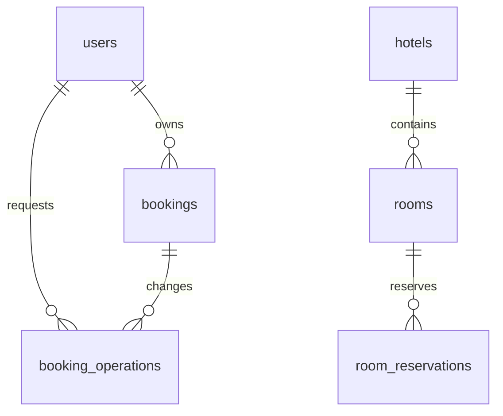

# Схема БД

У каждого backend-сервиса своя H2. FK между сервисами отсутствуют: `bookings.room_id`, `room_reservations.booking_id` — внешние идентификаторы. JPA создаёт схему при старте; исходные имена и ограничения заданы аннотациями сущностей.

## Booking

| Таблица | Поля и назначение |
|---|---|
| users | id PK identity; username UNIQUE NOT NULL; password BCrypt NOT NULL; role USER/ADMIN; enabled для мягкого удаления |
| bookings | id PK; user_id FK NOT NULL; room_id; start_date, end_date NOT NULL; status PENDING/CONFIRMED/CANCELLED; created_at, updated_at; reservation_id UUID; active_operation UUID; version для optimistic locking |
| booking_operations | id UUID PK — Idempotency-Key; user_id FK; booking_id FK; kind CREATE/UPDATE/CANCEL; fingerprint; trace_id; state PENDING/SUCCEEDED/FAILED; previous_reservation; снимок результата (room/date/status); failure_status/message; created_at |
| cleanup_tasks | id UUID PK — ключ освобождаемого резерва; booking_id; compensation; done; attempts; next_attempt_at; trace_id; version |

Индексы: bookings(user_id, created_at), bookings(room_id, start_date, end_date), booking_operations(state, created_at), cleanup_tasks(done, next_attempt_at). Пользователь блокируется через PESSIMISTIC_WRITE при начале/завершении операции, чтобы сериализовать изменения его бронирований и повторную доставку. Уникальный PK операций защищает ключи между пользователями.

## Hotel

| Таблица | Поля и назначение |
|---|---|
| hotels | id PK identity; name, address NOT NULL |
| rooms | id PK; hotel_id FK; number; available; times_booked BIGINT; version; UNIQUE(hotel_id, number) |
| room_reservations | id UUID PK — requestId; booking_id; room_id FK (nullable для метки освобождения); start_date, end_date; active; counted; fingerprint; created_at |
| allocation_lock | id PK, единственная строка 1; блокировка планировщика |

Индексы: rooms(times_booked, id), room_reservations(room_id, active, start_date, end_date), room_reservations(booking_id). Все изменения резервов и CRUD номерного фонда берут одну блокировку PESSIMISTIC_WRITE `allocation_lock(1)`. Это намеренно простой алгоритм для учебного H2: корректность и детерминированность при параллельной нагрузке важнее горизонтальной пропускной способности. Для большого объёма нужны запросы пересечений на уровне SQL и более мелкие блокировки.

Удалённые и компенсированные резервы сохраняются как tombstone, поэтому повтор запроса не воскресит бронь. История не удаляется каскадно. Слот имеет полуинтервал дат; пересечение: `old.start < new.end && old.end > new.start`.
